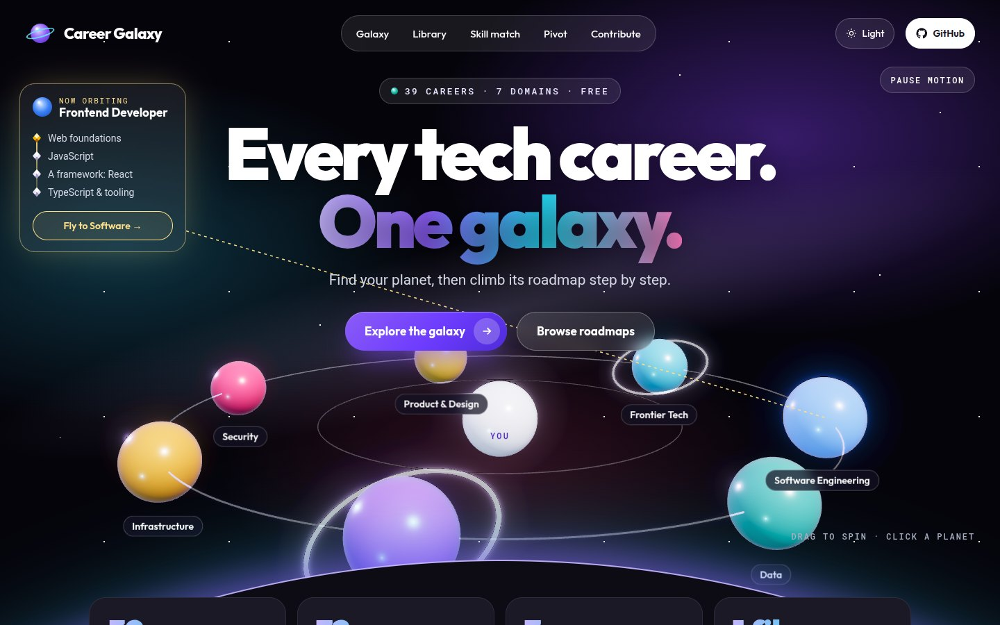
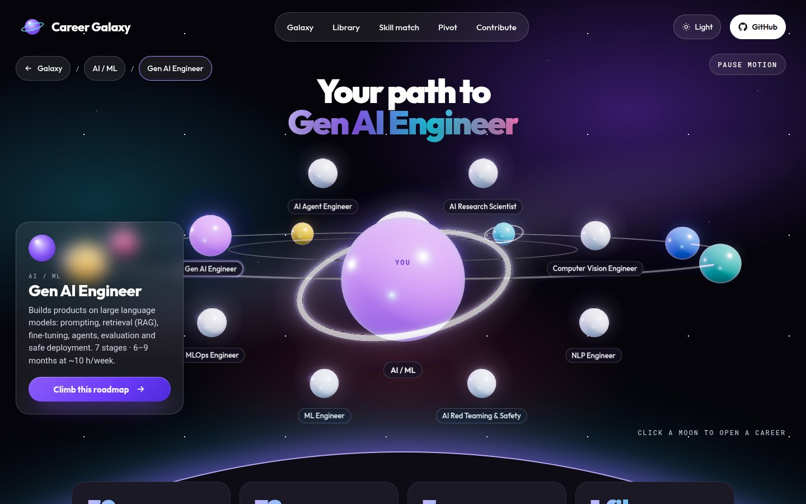
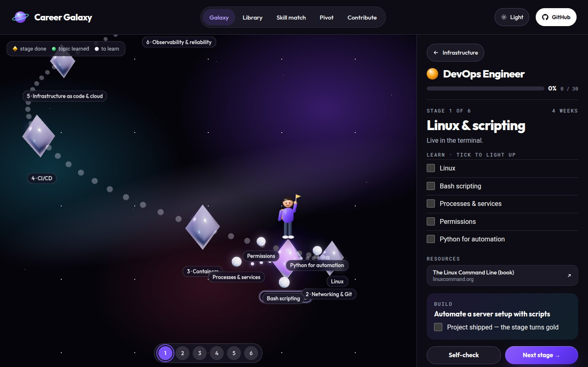
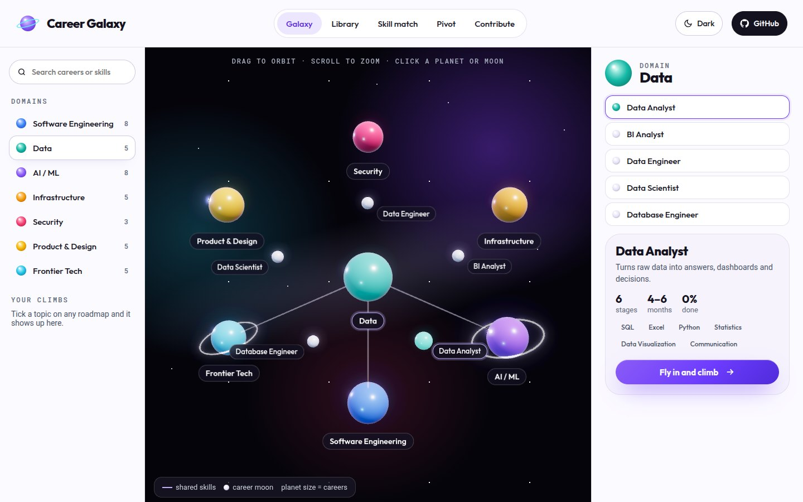
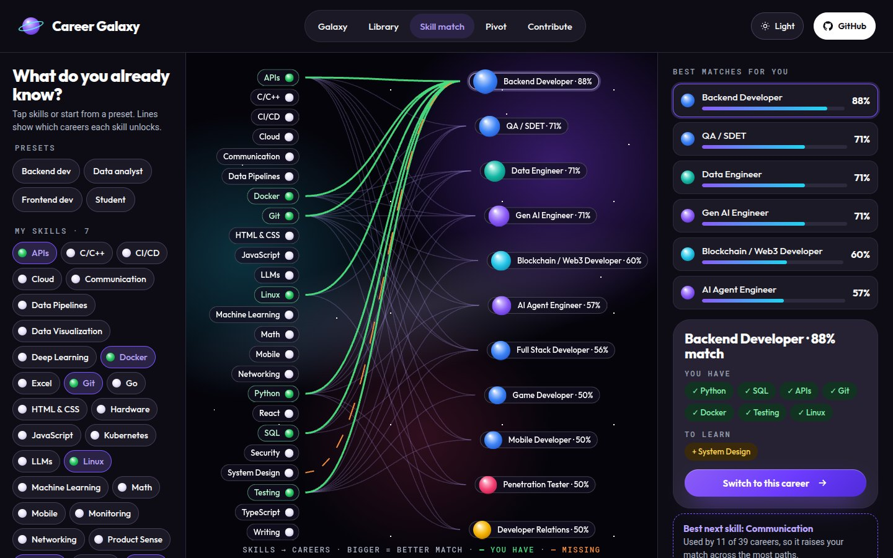
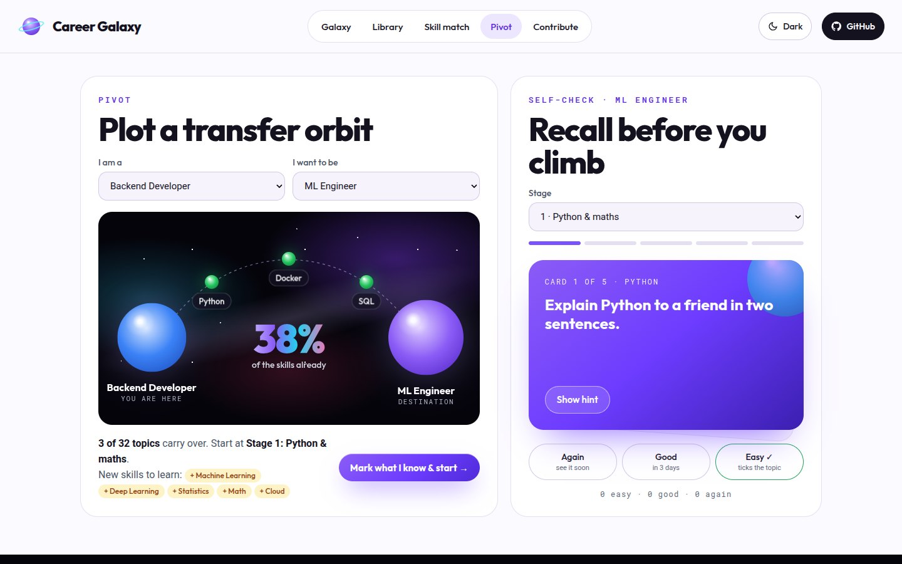
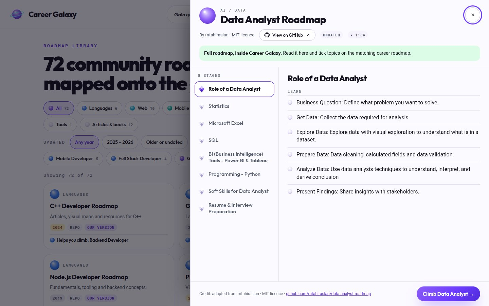

<div align="center">


# Career Galaxy

### Every tech career. One galaxy.

An open-source, interactive **3D atlas of tech career roadmaps**. Fly through 39 careers across 7 domains, climb step-by-step roadmaps, match your skills to careers, and switch paths without starting over.

[**Live demo**](https://career-roadmap-galaxy.vercel.app) · [Report a bug](../../issues/new?template=bug-report.yml) · [Propose a career](../../issues/new?template=new-field.yml) · [Contribute](CONTRIBUTING.md)

[](https://github.com/balavenkatesh3322/career-roadmap-galaxy/actions/workflows/ci.yml)
[](https://vercel.com/new/clone?repository-url=https://github.com/balavenkatesh3322/career-roadmap-galaxy)
[](LICENSE)
[](LICENSE-CONTENT.md)
[](https://pixijs.com/3d)
[](CONTRIBUTING.md)



</div>

---

## Why

Asking "how do I become a Data Scientist / DevOps engineer / Gen AI engineer?" usually gets you a flat list of 200 boxes. You can't tell where you are, what overlaps with what you already know, or what to do today. Career Galaxy turns that into a world you can explore:

- **See the whole landscape.** Every domain is a planet and every career is a moon.
- **Know the next step.** Each roadmap has 6 stages, and each stage has a goal, topics, free resources and a project.
- **Feel progress.** Ticked topics light up, finished stages turn gold, and a climber moves up your spiral.
- **Reuse what you know.** Pivot and Skill match show what carries over to a new career.

## Features

<table>
<tr>
<td width="50%"></td>
<td width="50%"></td>
</tr>
<tr>
<td><b>Fly in.</b> Spin the orbit and click a planet; its careers orbit as moons. Shareable: <code>/?domain=ai&role=gen-ai-engineer</code></td>
<td><b>Climb.</b> A 3D spiral of stages with topic satellites. Tick topics, ship the project and the stage turns gold. Progress is saved in your browser.</td>
</tr>
<tr>
<td></td>
<td></td>
</tr>
<tr>
<td><b>Explore.</b> Every domain and career, with links between domains that share the most skills, plus search.</td>
<td><b>Skill match.</b> Tick your skills and a PixiJS graph ranks careers, shows what's missing and suggests the best next skill.</td>
</tr>
<tr>
<td></td>
<td></td>
</tr>
<tr>
<td><b>Pivot and recall.</b> See what carries over between two careers and where to start, then test yourself with flashcards.</td>
<td><b>Library.</b> 72 community roadmaps readable in the app, credited, with a link to the original. Anyone can add one.</td>
</tr>
</table>

Also included:

- **Light and dark themes**, reduced-motion support, and keyboard-friendly 3D. Every label is a real button.
- **Add a career in one file.** `npm run new` scaffolds it, and the validator and CI keep quality high.

## Careers

| Domain | Careers |
|---|---|
| **Software Engineering** | [Frontend Developer](roadmaps/frontend.json) · [Backend Developer](roadmaps/backend.json) · [Full Stack Developer](roadmaps/full-stack.json) · [Mobile Developer](roadmaps/mobile.json) · [Game Developer](roadmaps/game-dev.json) · [Embedded & IoT Engineer](roadmaps/embedded-iot.json) · [QA / SDET](roadmaps/qa-sdet.json) · [Software Architect](roadmaps/software-architect.json) |
| **Data** | [Data Analyst](roadmaps/data-analyst.json) · [BI Analyst](roadmaps/bi-analyst.json) · [Data Engineer](roadmaps/data-engineer.json) · [Data Scientist](roadmaps/data-scientist.json) · [Database Engineer](roadmaps/database-engineer.json) |
| **AI / ML** | [ML Engineer](roadmaps/ml-engineer.json) · [MLOps Engineer](roadmaps/mlops.json) · [Gen AI Engineer](roadmaps/gen-ai-engineer.json) · [AI Agent Engineer](roadmaps/ai-agent-engineer.json) 🆕 · [AI Research Scientist](roadmaps/ai-research-scientist.json) · [Computer Vision Engineer](roadmaps/computer-vision.json) · [NLP Engineer](roadmaps/nlp-engineer.json) · [AI Red Teaming & Safety](roadmaps/ai-red-teaming.json) 🆕 |
| **Infrastructure** | [DevOps Engineer](roadmaps/devops.json) · [Site Reliability Engineer](roadmaps/sre.json) · [Cloud Engineer](roadmaps/cloud-engineer.json) · [Platform Engineer](roadmaps/platform-engineer.json) · [Network Engineer](roadmaps/network-engineer.json) |
| **Security** | [Cybersecurity (SOC) Analyst](roadmaps/soc-analyst.json) · [Penetration Tester](roadmaps/penetration-tester.json) · [DevSecOps / Cloud Security](roadmaps/devsecops.json) |
| **Product & Design** | [UX / UI Designer](roadmaps/ux-ui-designer.json) · [Product Manager](roadmaps/product-manager.json) · [Engineering Manager](roadmaps/engineering-manager.json) · [Technical Writer](roadmaps/technical-writer.json) · [Developer Relations](roadmaps/developer-relations.json) |
| **Frontier Tech** | [Blockchain / Web3 Developer](roadmaps/blockchain.json) · [AR / VR (XR) Developer](roadmaps/ar-vr.json) · [Quantum Computing Engineer](roadmaps/quantum.json) 🆕 · [Robotics Engineer](roadmaps/robotics.json) · [Forward Deployed Engineer](roadmaps/forward-deployed.json) 🆕 |

🆕 marks an emerging role, reviewed every 3 months.

## Tech stack

| Layer | Choice |
|---|---|
| 3D | [PixiJS 8](https://pixijs.com) + [PixiJS 3D](https://pixijs.com/3d) (`@pixi/3d`): glossy PBR planets, bloom, picking, orbit camera |
| UI | Plain HTML, CSS and JavaScript (ES modules), with no framework |
| Build | [Vite 7](https://vite.dev), multi-page, plus an SEO plugin for Open Graph, Twitter cards, sitemap and robots |
| Data | One JSON file per career in [`roadmaps/`](roadmaps) |
| Hosting | [Vercel](https://vercel.com) (`vercel.json`) with Vercel Web Analytics |

## Getting started

```bash
git clone https://github.com/balavenkatesh3322/career-roadmap-galaxy.git
cd career-roadmap-galaxy
npm install
npm run dev          # http://localhost:5179
```

| Script | What it does |
|---|---|
| `npm run dev` | Dev server with hot reload |
| `npm run build` | Validates every roadmap, then builds to `dist/` (with `sitemap.xml` and `robots.txt`) |
| `npm run preview` | Serves the production build |
| `npm run validate` | Checks the schema, ids, skills, links between careers and resource URLs |
| `npm run new -- <id> "<Title>" <domain>` | Scaffolds a new career |
| `npm run check-links` | Checks every resource link |

Requires Node 20 or newer and a browser with WebGL.

## Deploy to Vercel

1. Go to [vercel.com/new](https://vercel.com/new) and import this repository. The settings are read from [`vercel.json`](vercel.json): Vite framework, `npm run build`, output `dist`, clean URLs, cache and security headers.
2. Optional: set `VITE_SITE_URL` to your production URL under **Project → Settings → Environment Variables**. It's used for canonical links, social share images and the sitemap. The default is `https://career-roadmap-galaxy.vercel.app`.
3. Optional: turn on **Analytics** in the Vercel project for page-view stats.

Every push to `main` deploys to production, and every pull request gets a preview URL.

## Project structure

```
roadmaps/            one JSON file per career + index.json (domains, skills, roles)
src/scene/           PixiJS 3D scenes: space.js (shared), orbit, galaxyMap, climb, ring
src/pages/           one module per page
src/lib/             data, progress (localStorage), skill matching, flashcards, UI helpers
src/data/            community library index + imported content
src/styles/          design tokens, light/dark themes, components
public/              favicon, app icons, web manifest, social share images (og/)
scripts/             validate, scaffold, link check, library import
docs/                approved UX design, screenshots, teaching plan
```

## Contributing

Contributions are very welcome, especially new careers, better resources and fixes. Read [CONTRIBUTING.md](CONTRIBUTING.md) for the schema and style guide. In short:

```bash
npm run new -- context-engineer "Context Engineer" ai --emerging
# fill in roadmaps/context-engineer.json
npm run validate && npm run dev
```

Then open a pull request. Please follow our [Code of Conduct](CODE_OF_CONDUCT.md).

## Credits and licence

- **Code:** [MIT](LICENSE).
- **Roadmap content** (`roadmaps/`): [CC BY-SA 4.0](LICENSE-CONTENT.md).
- **Library:** entries come from [awesome-roadmaps](https://github.com/liuchong/awesome-roadmaps). Imported content keeps its original licence and credit; see [ATTRIBUTION.md](ATTRIBUTION.md).
- **Built with** [PixiJS](https://pixijs.com) and [PixiJS 3D](https://pixijs.com/3d). Fonts: Outfit, Roboto and Roboto Mono.

## Author

**Bala Venkatesh**: [balavenkatesh.is-a.dev](https://balavenkatesh.is-a.dev) · [GitHub](https://github.com/balavenkatesh3322) · Reach out: [+91 90038 12808](tel:+919003812808)

<div align="center"><sub>Made with ✦ by <a href="https://balavenkatesh.is-a.dev">Bala Venkatesh</a> and contributors. If it helped you, give it a ⭐.</sub></div>
