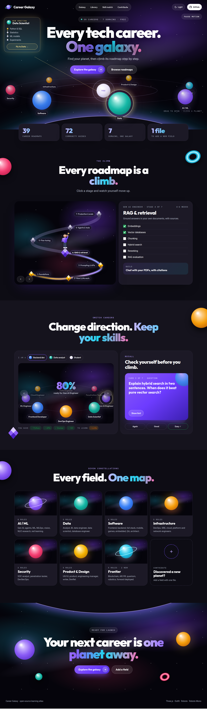

# Career Galaxy

**Every tech career, one galaxy.** An open-source, interactive 3D atlas of tech career roadmaps. Explore 39 careers across 7 domains, climb step-by-step roadmaps, match your skills to careers, and add new fields with one JSON file.

Built with [PixiJS](https://pixijs.com) and [PixiJS 3D](https://pixijs.com/3d).



## What's inside

| Page | What you can do |
|---|---|
| **Landing** (`/`) | Spin a 3D orbit of 7 domain planets around *you*. Click a planet to fly in, where its careers orbit as moons. Click a moon to open that career. The page also has a climb demo, a switch-careers ring and recall cards. |
| **Galaxy** (`/galaxy.html`) | Explore every domain and career. Glowing links join the domains that share the most skills. |
| **Roadmap** (`/roadmap.html?role=…`) | A 3D spiral of stages with a climber on your current stage. Tick topics, open free resources and ship each stage's project. Progress is saved in your browser. |
| **Pivot** (`/pivot.html`) | Pick where you are and where you want to go. See shared skills, the topics you already know and the stage to start at. Then test yourself with flashcards. |
| **Library** (`/library.html`) | 72 community roadmaps, readable in the app, mapped to the career each one helps with, and credited to their authors. |
| **Skill match** (`/skills.html`) | Tick your skills. A PixiJS graph links them to careers, ranks your best matches and suggests the best next skill to learn. |
| **Contribute** (`/contribute.html`) | Propose a new field. The page writes the JSON scaffold for you and opens a pre-filled GitHub issue. |

Every page has light and dark themes and respects *reduced motion*. 3D labels and controls are real buttons, so they work with a keyboard and screen readers.

## Run it

```bash
npm install
npm run dev        # http://localhost:5179
npm run build      # validates roadmaps, then builds to dist/
```

Node 20 or newer. Deploys to GitHub Pages through `.github/workflows/deploy.yml`. Turn this on under **Settings → Pages → Source: GitHub Actions**.

## Add or improve a career

Careers are plain JSON in [`roadmaps/`](roadmaps). Each one has 6 stages, and every stage has a goal, topics, free resources and a project.

```bash
npm run new -- context-engineer "Context Engineer" ai --emerging
# edit roadmaps/context-engineer.json, then:
npm run validate
npm run check-links
```

Read [CONTRIBUTING.md](CONTRIBUTING.md) for the schema and style guide.

## Project layout

```
roadmaps/            one JSON file per career + index.json (domains, skills, roles)
src/scene/           PixiJS 3D scenes: orbit, galaxy map, climb, ring
src/pages/           one module per page
src/lib/             data loading, progress, skill matching, flashcards, UI helpers
src/data/            library index + imported community roadmap content
scripts/             validate, scaffold, link check, library import
docs/                UX design (PNG exports + editable sources) and teaching plan
```

## Credits and licences

- Code: [MIT](LICENSE).
- Career roadmap content in `roadmaps/`: [CC BY-SA 4.0](LICENSE-CONTENT.md).
- Library entries come from the [awesome-roadmaps](https://github.com/liuchong/awesome-roadmaps) list. Imported content keeps its original licence and credit; see [ATTRIBUTION.md](ATTRIBUTION.md).
